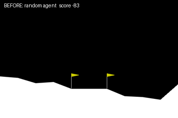
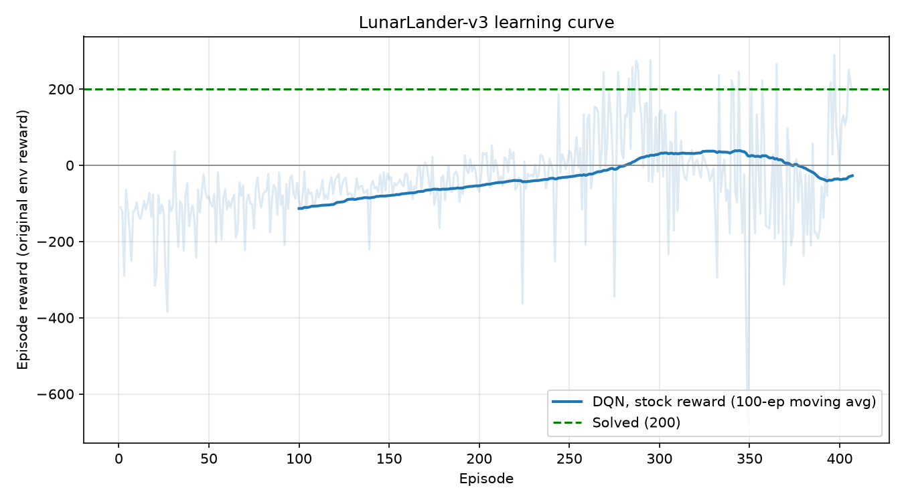

# Train an AI to Land a Rocket — LunarLander RL

A reinforcement-learning agent (DQN) that learns, by trial and error, to land a lander
between two flags in Gymnasium's `LunarLander-v3` physics simulator, plus an experiment
on **reward shaping**: how changing the reward changes what the agent learns.



## Results

| | Score (100-episode mean, stock reward) |
|---|---|
| Random agent (baseline) | **-141.8** (10 episodes, ± 112.7) |
| Trained DQN | **245.0 ± 49.8** (94/100 episodes ≥ 200, 0 crashes) — **solved** (≥ 200) |



## Phase 3 findings — reward shaping

Each run: DQN, same hyperparameters, seed 0, 300k steps (no early stop), best checkpoint by
periodic eval. Re-scored with `evaluate.py` over 100 episodes on the **stock** reward.

| Run | Extra term | 100-ep mean (stock) | Episodes ≥ 200 | First eval ≥ 200 (steps) |
|---|---|---|---|---|
| Stock (early-stopped at 125k) | none | 245.0 ± 49.8 | 94/100 | 125k |
| Tilt | −1.0 × abs(angle) per step | 244.7 ± 65.5 | 92/100 | 100k |
| Time | −0.3 per step | 262.3 ± 29.7 | 97/100 | 50k |
| Fuel | extra −0.3 when main engine fires | 253.5 ± 66.4 | 90/100 | 125k |

What it shows:
- **Time cost** reached a good policy fastest (first eval ≥ 200 at 50k steps) and gave the
  highest and most consistent final score. It nudges the agent to stop hovering. The risk is
  that a large time penalty can make a quick crash look cheaper than a careful descent;
  at 0.3 per step that did not happen here.
- **Tilt** helped a little (200 reached at 100k vs 125k) but the stock reward already
  penalises tilt, so the extra term mostly duplicates it.
- **Fuel** was slowest to reach 200 (125k, same as stock) and had the most spread in
  final score.
- All three scored within noise of stock on the stock reward, so none is a clear win.

Caveats: one seed per run, and eval checkpoints swing a lot (e.g. the time run's eval fell from
246 to −71 later in training), so differences of a few points or ~25k steps are not
conclusive. The stock run stopped at 125k, the shaped runs trained to 300k, and the
`--compare` table's training-average columns reflect that, so it is not a like-for-like
learning-speed comparison. Plots: `results/shaping_comparison.png`.

## Quick start (macOS)

```bash
bash setup_mac.sh                 # swig + Python venv + packages, then a self-check
source .venv/bin/activate
python src/smoke_test.py          # Phase 0: random agent crashes (baseline)
python src/train_dqn.py           # Phase 1: train; stops early once solved (~15-45 min CPU)
python src/evaluate.py --watch 3  # 100-episode test + watch 3 landings
python src/record_video.py        # Phase 2: results/lander.gif
python src/reward_shaping.py --shaping tilt   # Phase 3: shaped run (repeat with time / fuel)
python src/reward_shaping.py --compare        # table + results/shaping_comparison.png
```
Optional live charts: `tensorboard --logdir results/tensorboard`

## How it works — the RL concepts

**The loop.** Each step the agent sees a *state* (8 numbers: x, y, x-velocity, y-velocity,
angle, angular velocity, left-leg contact, right-leg contact), picks an *action*
(0 nothing, 1 left engine, 2 main engine, 3 right engine), and gets a *reward*.
Its only goal is to maximise total (discounted) future reward. Nobody tells it how to land.

**DQN (Deep Q-Network).** A neural net (2 × 256 units) learns Q(state, action): "how much
total reward will I collect if I take this action now and play well afterwards?" The agent
then just picks the action with the highest Q. Three tricks make it stable:
- **ε-greedy exploration** — early on it acts randomly (ε = 1.0) so it discovers things;
  ε decays to 0.1 as it gets better.
- **Replay buffer** — past transitions are stored and sampled randomly for training, which
  breaks the correlation between consecutive frames.
- **Target network** — a frozen copy of the net supplies the learning targets and is refreshed
  every 250 steps, so the agent isn't chasing a target that moves every update.

**Reward shaping — the core idea.** Landing gives a big reward, but a random agent almost
never lands, so a reward *only* for landing would give it nothing to learn from (the
*sparse reward* problem). LunarLander's built-in reward is already shaped to give a hint
every single step:

| Signal | Reward |
|---|---|
| Moving closer to the pad / slowing down / staying level | + (each step) |
| Moving away / speeding up / tilting | − (each step) |
| Each leg touching the ground | +10 |
| Main engine firing | −0.3 per frame |
| Side engine firing | −0.03 per frame |
| Landing safely and coming to rest | +100 |
| Crashing | −100 |

A clean landing on the pad totals roughly +100 to +140 from the shaping terms plus the +100
bonus — which is why "solved" is set at 200.

**The Phase 3 experiment** adds an extra term on top (stronger tilt penalty, per-step time
cost, or harsher fuel cost) and compares learning speed and behaviour. Shaping is
double-edged: a good hint speeds learning, but a careless one changes *what is optimal*.
For example, a large time penalty can make crashing quickly "cheaper" than a slow careful
descent. All runs are scored on the **original** reward (the `Monitor` wrapper sits inside
the shaping wrapper), so the comparison is fair and "solved" means the same thing.

**What the agent actually learns.** No physics model — just a mapping from those 8 numbers
to Q-values. Typical learned behaviour: fall freely at first, use short main-engine bursts
to brake, tap side engines to cancel drift and tilt, then cut engines once the legs touch.

## Project layout

```
src/smoke_test.py      Phase 0  random-agent baseline
src/train_dqn.py       Phase 1  DQN + EvalCallback (stops at 200) + TensorBoard + curve
src/evaluate.py        100-episode evaluation on the stock reward
src/record_video.py    Phase 2  before/after GIF
src/reward_shaping.py  Phase 3  shaping wrappers + comparison
src/common.py          hyperparameters, plotting helpers
results/               plots, GIF, models, logs
```

## Honesty notes

- "Build it in a day" is fair: setup plus a first solved agent fits in a day. Training time
  depends on your machine; 15–45 minutes on a laptop CPU is an estimate.
- RL in simulation is a real robotics research technique, but production rocket landing
  (e.g. SpaceX) uses physics-based guidance and control, not a learned policy like this one.
  This is a learning/portfolio project.
- Shaped-reward runs only count as "solved" if `evaluate.py` (stock reward) says so.
- Hyperparameters are the tuned LunarLander DQN settings from the RL Baselines3 Zoo.

## Stack
Python 3.10–3.12 · Gymnasium (`LunarLander-v3`, Box2D) · Stable-Baselines3 · PyTorch · Matplotlib · imageio
